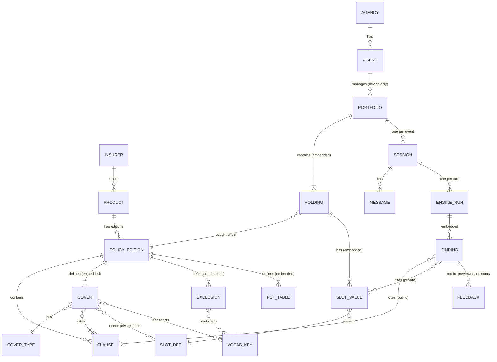

# ClaimFinder MVP — design for a one-pass implementation

> Working name. Audience: Claude Code, implementing the whole MVP from this document plus the
> `seed/` and `reference/` folders. UI language: Hebrew (RTL). Code, comments and docs: English.

**Source-of-truth order, when two things disagree:**
1. `reference/engine_ref.py`, `reference/expected_results.json` and `reference/validate_seed.py` (executable spec).
2. This document.
3. Your own judgment. Record every judgment call in `DECISIONS.md` (one line each) and keep going; don't stop to ask.

---

## 0. The product in one paragraph

An Israeli insurance agent (סוכן ביטוח) describes something that happened to a client, in free Hebrew text:
"נפל מסולם, שבר בצוואר הירך, 4 ימי אשפוז". The system cross-checks the client's personal-accident
policies (several insurers, each in a specific **edition** of the wording) against a **public library of rules**
extracted from the published policy wordings. It returns every entitlement it can find. Each entitlement has:
- the amount, or the formula when the client's private sums are missing;
- the exact clause it rests on;
- what still needs verifying.

It asks the agent only the few questions that change the money. The agent is the user; the end client never sees the tool.

### 0.1 Scope

| In scope (MVP) | Out of scope (later) |
|---|---|
| Personal accident (תאונות אישיות) family only | Health, critical illness, disability income, life, property |
| 2 seeded editions + about 8 more through Policy Studio (M4, §8), then whatever the pilot agents' books need | Automatic crawling of insurer sites |
| Find mode (event → entitlements) and Ask mode (question → cited answer) | Filing claims, contacting insurers |
| Client data entered and kept **on the agent's device only** (§3.5–3.6): typed, public plans, status policies, Har HaBituach Excel import parsed in the browser, and (M7) schedule PDFs parsed in the browser | Any server-side storage of client data; live integrations with PolyWizz / Bafi / Har HaBituach / insurer portals |
| Local only: FastAPI + local MongoDB + Vite build, exposed through a tunnel to 2–3 agents while the developer's computer is on. The app has no availability rules; the owner starts and stops it. | Cloud deploy, multi-tenant scale, billing |

### 0.2 Invariants (never break these; tests enforce them)

1. **We hold no client data** (in the active privacy profile, `device_only`; §3.8 explains how to switch later). Portfolios, sums, holding dates, event facts, runs and exports live only in the agent's browser (IndexedDB) on the agent's computer. The engine and the chat flow run there too. The server holds only:
   - the public library;
   - agent accounts;
   - usage and telemetry counts;
   - policy requests;
   - opt-in feedback.

   The only client-related content that crosses the network is the event or answer text needed for fact extraction, under two conditions:
   - it's scrubbed in the browser before it leaves;
   - the server passes it to the LLM without storing or logging it.

   **Manual mode** sends nothing at all (§6.6).
2. **The LLM never computes money and never decides eligibility.** It only turns Hebrew text into vocabulary facts, and answers Ask-mode questions with quotes from public clauses. The deterministic engine decides and computes.
3. **Every finding carries a proof chain (§5.2).**
   - **From the event:** the facts used, each with the agent's own words.
   - **From the policy:** quotes that are literally inside the clause text. Each clause is located on a page of an archived, hashed copy of the insurer's published PDF.
   - **From the schedule:** each sum used, with where it came from.
   - **The calculation:** the formula, with the numbers filled in.

   Enforcement:
   - A cover without clauses or evidence can't be loaded (validator + Mongo `$jsonSchema`).
   - The validator rejects any quote that isn't inside its clause text.
   - An `expert_approved` edition must have page references, full clause texts and a quote for every table row.
4. **Private amounts come only from slots.** These are values the agent typed or imported on the device, or that come from a public plan the agent chose. They never come from an LLM guess. They never leave the device.
5. **No client identity anywhere, not even on the device** (in `device_only`; identity fields exist in the schema but are disabled, §3.8). No names, ID numbers, phone numbers, policy numbers or birth dates; a portfolio has only a nickname. Imported files are parsed in the browser and discarded; only whitelisted fields are kept (§3.6).
6. **Runs are reproducible.** Every run (stored on the device) keeps the facts snapshot, the portfolio snapshot hash and the `library_version`.
7. **Findings from a `draft` edition are labeled "טיוטה – לא אומת"** everywhere they appear, including the export.

---

## 1. Glossary

| Term | Hebrew | Meaning |
|---|---|---|
| Insurer | חברת ביטוח | AIG, Clal, Harel… |
| Product | מוצר | A product line, e.g. "AIG ACTIVE". It has many editions. |
| Edition / policy | מהדורת פוליסה | One exact wording, e.g. `aig_active_0613`, sold 03.07.2013–30.11.2014. A holding is bound to one edition. |
| Clause | סעיף | A numbered piece of the wording (`ב.4.1`) with verbatim text. The unit of citation. |
| Cover | כיסוי | One benefit inside an edition (fractures, hospital daily…). It has one `rule`. |
| Cover type | סוג כיסוי | A cross-insurer category (`fractures`), used to compare and rank. |
| Fact / vocab key | עובדה | A typed fact about the event (`hospital_days`, `fracture_sites`). Filled by the LLM from the agent's text, or by the agent's answers. |
| Slot | שדה פרטי | A private per-client value from the schedule (`sum.fractures`). Never in the vocab. |
| Holding | אחזקה | "This client holds edition X since date D, bought covers C, with slots S." |
| Plan / track | מסלול | A fixed variant of an edition with public sums (e.g. "מסלול 100,000 ₪"). Choosing it fills the slots. |
| Status policy | ביטוח סטטוס | A group policy that covers a person because of a status (e.g. a child in compulsory education). No private sums. |
| Portfolio | תיק | The holdings of one (anonymous) client. Stored only on the agent's device. |
| Session | שיחה | One event discussed in chat against one portfolio. Stored only on the agent's device. |
| Device store | אחסון במכשיר | IndexedDB in the agent's browser: portfolios, sessions, runs. The server never sees it. |
| Manual mode | מצב ידני (ללא שליחה) | The event is entered with buttons instead of free text, so nothing about the case leaves the device. |
| Run | ריצה | One engine evaluation (one per turn). |
| Finding | ממצא | One cover × one holding in a run: status, amount, citations, open items. |
| Gate | שער | The rule part that says "this cover is relevant at all". |
| ask_when | מתי לשאול | When the gate is unknown, should we ask? (severity trigger) |
| Checklist | רשימת אימות | Things to verify before filing. Never asked as questions. |
| Proof chain | שרשרת הוכחה | For each finding: the agent's words → the clause quote, with page in the archived PDF → the schedule value → the calculation (§5.2). |

---

## 2. Architecture

```
 Agent's browser (Hebrew RTL SPA) ─────────────────────────────── everything about the client stays here
   ├─ library cache      public bundle (editions, clauses, vocab, slots, catalog), versioned, from GET /api/library/bundle
   ├─ device store       IndexedDB: portfolios, sessions, messages, runs, settings   (never uploaded)
   ├─ intake             edition resolution (§3.7), plans, status policies, Har HaBituach .xlsx import (SheetJS), M7 PDF (pdf.js)
   ├─ scrubber           removes IDs / phones / emails / card numbers before any text leaves
   ├─ chat orchestrator  merge facts, pick questions, templates (Hebrew)
   └─ engine             TypeScript port of reference/engine_ref.py (pure, deterministic)
            │
            │  only: scrubbed event/answer text → facts;  question + public edition ids → cited answer;
            │        counts-only telemetry; opt-in feedback (previewed first)
            ▼  HTTPS (tunnel: cloudflared / ngrok) ← only port 8000 is exposed
 FastAPI (uvicorn, single process, 127.0.0.1:8000)
   ├─ middleware: auth cookie · rate limit · request log WITHOUT bodies
   ├─ /api/library/*   serve the public library bundle
   ├─ /api/extract     stateless LLM proxy: text → vocab facts (Claude, structured output); nothing stored
   ├─ /api/ask         BM25 over public clauses → Claude → citation validator; nothing stored
   ├─ /api/telemetry · /api/feedback · /api/policy-requests · /api/studio/*
   └─ static: built frontend (frontend/dist)
            ▼
 MongoDB (local, 127.0.0.1:27017, db "claimfinder")
   public library: insurers, products, policy_editions, clauses, vocab_keys, vocab_sets, site_defaults,
                   slot_defs, cover_types, library_releases
   server-only, no client data: agencies, agents, invites, usage, telemetry, feedback, policy_requests, ingest_jobs
```

One turn, step by step (all in the browser unless marked):
1. The agent's text is scrubbed.
2. **Server, stateless:** `POST /api/extract` turns the text into `{key: value|null}` plus evidence quotes.
3. The facts merge into the session, in the device store.
4. The engine produces findings, questions, slot requests and a checklist, using the portfolio's slots on the device.
5. The orchestrator picks at most 3 questions.
6. Templates render a short Hebrew message.
7. The run and the messages are saved in the device store.
8. A counts-only telemetry event is sent (§3.5.1).

Button answers and manual mode skip the server entirely.

---

## 3. Data model

### 3.1 How the two layers meet (the core idea)

Nothing in the public library knows about any client, and nothing in the private layer contains policy logic.
They meet only inside `engine.run`, through these join keys:

| Join key | Connects | Example |
|---|---|---|
| `edition_id` | holding → policy edition | `h1.edition_id = "aig_active_0613"` |
| vocab `key` | fact in a session ↔ `{"var": key}` in a rule | `hospital_days` |
| slot `key` | slot value in a holding ↔ `{"slot": key}` in a rule ↔ `slot_defs` | `sum.fractures` |
| `clause_no` (+ edition) | rule/finding → clause text | `aig_active_0613#א.21` |
| `cover_type` | cover ↔ catalog (ranking, comparison, `covers_bought`) | `fractures` |

A computed amount (35% × 20,000 = 7,000 ₪) exists in neither layer. It's produced at runtime in the browser and stored only in the run, on the device.

The public library lives on the server and is cached in the browser. The private layer exists only in the browser.

### 3.2 Logical model

Everything from `PORTFOLIO` down to `FINDING` lives in the device store. Everything else lives on the server.



### 3.3 Storage decisions

- **Covers, exclusions, tables, site_map, plans and scope are embedded in `policy_editions`.** They're always read together, versioned together and small (< 100 KB).
- **Clauses are a separate collection.** They're large, searched independently (Ask mode, citation drawer) and addressed by `(edition_id, clause_no)`.
- **The browser gets the whole public library as one versioned bundle** (`GET /api/library/bundle`, with an ETag) and caches it. Today that's a few hundred KB; split it per edition if it grows past ~5 MB.
- **Portfolios embed their holdings and slot values. Runs embed their findings.** Both live in IndexedDB on the device (§3.5.2).
- **Library documents use readable string `_id`s** (`aig_active_0613`, `aig_active_0613#ב.4.1`, `sum.fractures`). Device records use random UUIDs.

### 3.4 Public library collections

All are loaded from `seed/` by `python -m app.cli seed`. They're read-only at runtime.

**`insurers`** `{_id: "aig", name_he, site}` and **`products`** `{_id: "aig_active", insurer_id, family: "personal_accident", name_he, aliases_he: [...], edition_rule, renewal_updates_edition, era: "legacy"|"post_reform"|"status", sponsor_he?}`, both from `seed/catalog.json`. `edition_rule` is explained in §3.7.

**`policy_editions`**, one per `seed/policies/*.json`:
```jsonc
{
  "_id": "aig_active_0613",
  "insurer_id": "aig", "product_id": "aig_active", "family": "personal_accident",
  "insurer_he": "AIG ישראל", "name_he": "AIG ACTIVE – ביטוח תאונות אישיות",
  "doc_code": "30509", "edition_label": "06/13",
  "sold_from": "2013-07-03", "sold_to": "2014-11-30",     // null = unknown
  "supersedes": null, "superseded_by": "aig_active_0817",
  "source": {"url": "https://www.aig.co.il/...pdf",        // where the insurer published it
             "sha256": "…", "fetched_at": "2026-10-20",      // what exactly we read, and when
             "archived_path": "library_files/aig_active_0613/source.pdf", "pages": 24},
  "review": {"status": "reviewed_demo", "flags": [{"field": "...", "reason_he": "..."}]},
  "scope":   {"expr": {...}, "clauses": ["א.1"], "label_he": "..."},
  "covers":  [ { "cover_id", "cover_type", "name_he", "clauses": [...], "slots": [...], "rule": {...},
                 "evidence": [ {"claim_he": "צוואר הירך = רגל (לא אגן)", "clause": "א.21",
                                "quote": "עצמות ראש הירך וצוואר הירך הינן בגדר רגל ולא אגן"} ] } ],
  "exclusions": [ {...} ],
  "tables":  { "fracture_pct": { "clauses", "cap_pct", "same_bone_once", "rows": {"leg": 35, ...},
                                 "row_quotes": {"leg": {"clause": "ב.4.1-לוח", "quote": "שבר ברגל … 35%"}, ...} } },
  "site_map": { "femoral_neck": {"to": ["leg"], "clauses": ["א.21"], "quote": "…", "ambiguous": false, "note_he": "..."} },
  "claims":  { "limitation_years": 3, "clauses": ["ו.11"], "notify_he": "...", "general_docs_he": [...] },
  "library_version": "lib-2026-10-17.1"
}
```
Optional `plans[]`: `{plan_id, name_he, slots: {"sum.death": 100000, ...}, clauses: [...]}`. Used by products sold in fixed tracks and by status policies; the sums are public. For products whose `edition_rule` is `event_date` (§3.7), `sold_from`/`sold_to` mean the policy period.

`$jsonSchema` validator (minimum):
- `covers` has `minItems: 1`;
- each cover has `clauses` with `minItems: 1`, and an `evidence` array;
- `review.status` is in `[draft, reviewed_demo, expert_approved]`.

**`clauses`**:
```jsonc
{ "_id": "aig_active_0613#ב.4.1", "edition_id": "aig_active_0613", "clause_no": "ב.4.1", "order": 11,
  "title": "שברים – התחייבות המבטח", "text": "...verbatim...",
  "text_source": "pdf_text" | "pdf_vision" | "webfetch_excerpt" | "webfetch_quote_unverified" | null,
  "text_complete": true,                                 // false = stored as an excerpt with "..."
  "page_from": 7, "page_to": 7,
  "bboxes": [{"page": 7, "rect": [x0, y0, x1, y1]}],     // PDF coordinates, for highlighting the original
  "verified": {"method": "text_layer_match" | "vision_match" | "human", "by": "…", "at": "…"} | null,
  "norm": "...normalized text for search...", "tokens": ["..."] }
```
Indexes:
- unique `(edition_id, clause_no)`;
- `(edition_id, order)`.

`text` may be `null` only in `draft` editions. Show "נוסח הסעיף טרם נשמר" instead.

The archived PDFs of all editions sit under `library_files/<edition_id>/source.pdf`. They're public documents, served read-only (§9) so an agent can open the original page. If the insurer later removes or replaces the file, the archived copy and its sha256 still prove what the wording said when we read it.

**`vocab_keys`** (from `vocab.json → keys`), `_id = key`, fields as in the seed:
- `type` is one of `enum`, `enum_list`, `number`, `bool`, `date`;
- `values[{v, he, syn?, refine_to?, refine_he?}]`;
- `label_he`, `ask_he?`, `unit?`.

**`vocab_sets`** `{_id: "major_fracture_sites", members: [...]}` and **`site_defaults`** `{_id: "femoral_neck", categories: ["leg"]}`.

**`slot_defs`** `{_id: "sum.fractures", unit, label_he, cover_type, source_hint_he}` plus the holding fields (`start_date`, `last_renewal_date`, `doc_code`, `insured_is_child`, `insured_age_at_start`). These are definitions only; the values live on the device. **`cover_types`** `{_id, label_he, rank_weight}`.

**`library_releases`** `{_id: "lib-2026-10-17.1", created_at, content_sha256, editions: [...ids], vocab_count, notes}`.
- `seed` computes a hash over all seed files.
- If the hash is unchanged, it's a no-op. Otherwise it creates a new release and stamps every edition document.
- Sessions on the device pin the release current at creation. Runs record it. If the bundle changes mid-session, the session keeps its pinned release until the agent starts a new one.

### 3.5 What lives where

#### 3.5.1 Server collections (no client data)

**`agencies`** `{_id, name, created_at, notes}`

**`agents`** `{_id, agency_id, display_name, role: "agent"|"admin", created_at, last_seen_at}`. There's no email or phone. Auth is an invite code plus a display name.

**`invites`** `{_id, code_hash, agency_id, max_uses, uses, expires_at, created_at}`

**`usage`** `{_id, agent_id, ts, kind: "extract"|"ask"|"ingest", model, in_tokens, out_tokens, latency_ms, cost_usd|null}`. Never request or response bodies.

**`telemetry`** `{_id, agent_id, ts, kind: "run"|"session_start"|"import", library_version, edition_ids: [...], cover_types: [...], status_counts: {payable: 2, ...}, questions_asked: 3, turn: 1, manual_mode: false, unmapped_count: 1}`.
- The server rejects any other key (pydantic model with `extra="forbid"`).
- No amounts, no fact values, no dates, no nickname.

**`feedback`** (opt-in; the agent sees the exact payload before sending) `{_id, agent_id, ts, kind: "up"|"down"|"missed"|"wrong_question"|"case_review", edition_id|null, cover_id|null, status|null, comment_he (scrubbed), case: null | {facts, edition_ids, statuses}}`
- `case` is filled only for an explicit "שלח מקרה לבדיקה".
- `case.facts` holds fact values with `event_date` reduced to month/year.
- Never sums, nickname or holding dates.

**`policy_requests`** `{_id, agent_id, insurer_text, product_text, year_text, url|null, note_he, status: "open"|"in_progress"|"done"|"rejected", edition_id|null, created_at}`. These are public product facts, the demand signal for Policy Studio (§8).

**`ingest_jobs`** `{_id, edition_id, product_id, mode: "new_product"|"new_edition", base_edition_id|null, source_url, step, status, artifacts_dir, flags_open, cost: {in_tokens, out_tokens}, created_by, created_at, updated_at}`

#### 3.5.2 Device store (IndexedDB, via the `idb` package)

Database `claimfinder`, scoped to the agent's browser profile on that computer.

**`portfolios`**:
```jsonc
{ "id": "uuid", "label": "תיק 17 – AIG+כלל",          // nickname only; scrubbed on save
  "holdings": [
    { "holding_id": "h1", "product_id": "aig_active", "edition_id": "aig_active_0613",
      "edition_basis": "rule" | "doc_code" | "nearest" | "agent_pick",
      "edition_date_used": "2014-01-01",
      "plan_id": null,
      "start_date": "2014-01-01", "last_renewal_date": null, "doc_code": null,
      "insured_is_child": false, "insured_age_at_start": null,
      "covers_bought": ["death","permanent_disability","hosp_daily","fractures","recovery_weekly"],
      "slots": { "sum.fractures": {"value": 20000, "source": "typed"|"plan"|"import", "confirmed": true,
                                   "source_ref": null | {"file_name", "page", "line"}} } } ],
  "created_at", "updated_at" }
```
- `covers_bought` defaults to all covers of the edition. The agent can untick.
- Only `confirmed: true` slots reach the engine. Plan values are confirmed by definition.
- For `event_date` products, `edition_id` stays `null` until the session knows the event date (§3.7).

**`sessions`**:
```jsonc
{ "id", "portfolio_id", "library_version", "fact_finder": true, "manual_mode": false,
  "state": "awaiting_event" | "active" | "closed",
  "facts": { "hospital_days": {"value": 4, "source": "text"|"answer"|"agent_edit"|"form", "turn": 0, "quote": "4 ימי אשפוז"} },
  "declined": ["prior_fracture_same_site_paid"], "asked": {"permanent_disability": 1},
  "turn": 1, "unmapped_he": ["ניתוח"],
  "messages": [ {"role": "agent"|"assistant", "kind", "text_he", "payload", "ts"} ],
  "runs": [ <RunResult, see §5> ],
  "created_at", "updated_at", "expires_at" }
```
Local retention (checked on every app start):
- Sessions past `expires_at` are deleted (`LOCAL_SESSION_TTL_DAYS`, default 30).
- Portfolios not opened for `LOCAL_PORTFOLIO_TTL_DAYS` are deleted (default 180; the settings offer 30 / 90 / 180 / never). From 14 days before deletion, a banner names the portfolios at risk and offers the encrypted export.
- "מחק הכל מהמכשיר" wipes the database.

Storage rules:
- **IndexedDB only.** Never put client data in cookies: browsers send cookies to the server with every request. Don't use `localStorage` for it either, since it's small and synchronous. `localStorage` may hold UI preferences only.
- **Ask the browser to keep the data.** On the first save, call `navigator.storage.persist()`, and show the result in settings ("האחסון מוגן" / "האחסון עלול להימחק").
- **Safari.** Safari deletes script-written storage, IndexedDB included, for a site that hasn't been visited for 7 days (ITP). If Safari is detected, show a one-time notice: "מומלץ Chrome / Edge, או להוסיף את האתר ל-Dock". A site added to the Dock runs as a web app and is exempt. Ship a minimal web-app manifest so that option works.
- **The origin must never change.** IndexedDB belongs to one origin (scheme + host + port). If the app's URL changes, the agent's data "disappears", because it's still stored under the old URL. So the trial must run on a stable URL (§13.2).

**Moving to another computer.** "ייצוא מוצפן" writes the portfolios to a `.cfx` file:
- encryption is AES-GCM, with the key derived from a passphrase the agent types (PBKDF2, 310k iterations, via WebCrypto);
- "ייבוא" reads it back on the other computer.

The file never touches our server.

#### 3.5.3 What crosses the network

| Request | Contains | Stored by us? |
|---|---|---|
| `GET /api/library/bundle` | Nothing about clients | — |
| `POST /api/extract` | Scrubbed event/answer text, the keys being asked, today's date | No: passed to the LLM, then dropped. `usage` keeps token counts only. |
| `POST /api/ask` | Scrubbed question + public edition ids | No (counts only) |
| `POST /api/telemetry` | Counts only (§3.5.1) | Yes: counts |
| `POST /api/feedback` | What the agent saw in the preview and chose to send | Yes |
| `POST /api/policy-requests` | Public product info | Yes |

What we never receive: the portfolio, its nickname, slot values, holding dates, doc codes, run results and exports.

### 3.6 Private intake: how per-client data gets in (all on the device)

Per holding the engine needs exactly this, and nothing else:

| Field | Why | Where the agent finds it |
|---|---|---|
| Insurer + product (+ plan/track when the product has fixed tracks) | Picks the edition; a plan also gives the sums | Schedule (דף פרטי ביטוח), annual report (דוח שנתי), Har HaBituach, the agent's own system |
| The date the product's `edition_rule` needs: start date, or last renewal date | Picks the edition (§3.7) | Schedule / annual report / Har HaBituach |
| Doc code or edition label, when printed | Exact edition match | Schedule, policy cover page |
| Covers bought | Which covers to evaluate | Schedule |
| Sums per cover, daily/weekly amounts, waiting days | The slots | Schedule / annual report |
| Insured is a child / age at joining | Some rules depend on it | Schedule |

**Never collected, even on the device:** name, ID number, address, phone, date of birth, policy number, premium, beneficiaries, payment details. The agent's own system keeps the link between the nickname and the client.

Ways in, in build order:
1. **Typed** (M3): the builder form asks for the fields above, and only those.
2. **Plan-derived** (M3): when an edition defines `plans`, choosing a plan fills its slots from public data (`source: "plan"`). Examples are a product sold in fixed tracks ("מסלול 100,000 ₪") or a group policy with fixed sums.
3. **Status policies** (M3 UI; editions added in M4): group policies that cover a person because of a status, e.g. every child in compulsory education under the Ministry of Education student policy. The builder offers "הוסף ביטוח סטטוס" with a yes/no question ("הנפגע תלמיד בחינוך חובה?").
4. **Har HaBituach Excel import** (M3), parsed in the browser with SheetJS. Nothing is sent anywhere.
   - Only whitelisted columns are read: insurer, product/policy type, plan name if present, period start and end.
   - Every other column (ID, policy number, premium, names) is never copied out of the parsed sheet, and the file object is released after parsing.
   - PA rows are matched to products with `aliases_he` (§3.7), and become proposed holdings that the agent confirms.
   - Sums usually aren't in this export (confirm with the pilot agents), so step 3 (סכומים) asks for them later, only when a finding needs them.

**Sums are usually CPI-linked.** The slot form asks for the values from the latest annual report and says so ("לפי הדוח השנתי האחרון"). Indexing older values is out of scope for the MVP.
5. **Schedule / annual report PDF** (M7), parsed in the browser with pdf.js.
   - A label dictionary maps cover lines to slots ("שברים" → `sum.fractures`, "פיצוי יומי באשפוז" → `daily.hospital`), together with the amount on the same line.
   - Product, plan and dates are matched the same way.
   - Lines that look like IDs, phones or names (scrubber rules, plus "שם", "ת.ז", "כתובת" labels) are dropped.
   - **Optional LLM fallback** (off by default): the agent sees a preview of exactly which lines would be sent ("זה מה שיישלח") and approves. Only those lines go to `POST /api/extract` in `intake` mode.

### 3.7 Edition resolution (runs in the browser against the public bundle)

**Inputs:** product (picked from a list or matched from imported text), a date, and an optional doc code or edition label.

**Step A – identify the product.**
- From the picker: insurer → product.
- From imported text: normalize the text (lowercase Latin letters, strip niqqud and punctuation), then match it against each product's `name_he` + `aliases_he`, scored by token overlap.
  - A score of 0.6 or more makes a candidate.
  - The agent confirms the top candidate, or picks another product.
- Nothing matches → "המוצר לא בספרייה" → a prefilled policy request (insurer/product/year only).

**Step B – choose the date by the product's `edition_rule`:**
- **`start_date`**: legacy individual policies (sold before the 1.5.2021 PA reform; they stay in force unchanged). The date is the holding's start date.
- **`last_renewal`**: post-reform products (2-year term; renewal needs the client's consent). The date is the last renewal date, falling back to the start date.
- **`event_date`**: group/status policies with a fixed period, e.g. one edition per school year. The date is the event date. It's resolved during the session, after extraction. If it's unknown, the orchestrator asks for it as a tier-1 question and leaves this holding out of the run until it's answered.
- Products also carry `renewal_updates_edition` (default `false`). When `true`, a legacy product behaves like `last_renewal`. It's an assumption to confirm per product; see §17.
- The agent may enter only a month/year. The date is then a range, and every edition overlapping that range is a candidate.

**Step C – candidates** = the product's editions whose `[sold_from, sold_to]` contains the date. A `null` bound means "unknown"; it matches, but is marked as uncertain.

| Situation | Result |
|---|---|
| A doc code or edition label is given and matches | That edition, `edition_basis: "doc_code"` (wins over dates) |
| Exactly one candidate with known bounds, and the date is more than `EDITION_BOUNDARY_MARGIN_DAYS` (default 30) from its edges | That edition, `edition_basis: "rule"` |
| The date is within the margin of an edition boundary (sale date and start date can differ by weeks) | Both editions are candidates. Preselect the rule's pick; the sensitivity check (§5.1) shows whether the choice matters for the event. |
| Several candidates (overlap, month-only date, or `null` bounds) | The agent picks. Each option shows its date range and covers list. `edition_basis: "agent_pick"` |
| No candidate: the edition isn't in our library | Show the nearest library editions before and after with their ranges, and offer three choices. **(a)** Request the missing edition (prefilled request). **(b)** Calculate with the nearest earlier edition: `edition_basis: "nearest"`, the card is labeled "מהדורה משוערת" and every finding gets the verify item "המהדורה בפועל לא בספרייה – ייתכנו הבדלים בתנאים". **(c)** Skip the holding. |

**Step D – record and show.** Store `edition_basis` and `edition_date_used` on the holding. The holding card says, e.g., "מהדורה 06/13 – לפי תאריך הצטרפות 01.01.2014".

Worked examples (AIG ACTIVE; date ranges from AIG's site):

| Holding date | Library editions | Outcome |
|---|---|---|
| 01.01.2014 | 06/13 = 03.07.2013–30.11.2014 | `aig_active_0613`, basis `rule` |
| 10.02.2015 | No edition collected for 01.12.2014–31.03.2016 | "Not in library" → request, or nearest (06/13) labeled "מהדורה משוערת" |
| 15.05.2016 | 01.04.2016–31.07.2017 (target `aig_active_0416`) | That edition once ingested; until then, the same as the previous row |
| "2017" (year only) | 0416 and 0817 both overlap 2017 | The agent picks; the cards show both ranges |
| Clal Haganat Atzmit, 01.03.2019 | `sold_from`/`sold_to` unknown | Uncertain match → the agent confirms |
| Student policy, event 01.10.2026 | 2026–27 school year | `moe_students_2026_27` |

### 3.8 Built for change: data classes, privacy profiles and storage adapters

Today we keep nothing about clients. If we later get approval to keep more, for example a client name or an ID number for agencies that want it, that must be a configuration change plus one new adapter, not a rewrite. Three mechanisms make that true, and all three are built in the MVP even though only the default is active.

**1. Every field has a data class** (`seed/data_classes.json`).

| Class | What it is | Where it may live in `device_only` |
|---|---|---|
| `public` | Policy wordings, rules, vocab, catalog | Server |
| `agent_account` | Agent display name, agency | Server |
| `counts` | Aggregates without values | Server |
| `case_private` | Which policies and editions, dates, covers, sums, totals | Agent's device |
| `case_health` | Event text, facts, findings | Agent's device; scrubbed text may transit to the LLM |
| `identity` | Name, ID number, phone, birth date, policy number | **Not collected** (fields exist, disabled) |

Code never hard-codes these decisions. The store, the scrubber, the LLM payload builder, telemetry, feedback and export all ask the registry: "may field X of class C go to destination D under the active profile?"

**2. Privacy profiles.** The active one is `device_only`. Two more are specified and reserved:

| Profile | Where client data lives | Identity fields | What switching takes |
|---|---|---|---|
| `device_only` (active) | IndexedDB on the agent's computer | Disabled | — |
| `encrypted_sync` (reserved) | The device, plus an encrypted copy on our server that **we can't read**. The key is derived from an agency passphrase and never leaves the agency's devices. Gives multi-computer access and backup. | Optional per agency, inside the ciphertext only | `EncryptedSyncStore` adapter + `/api/v2/vault/*` blob endpoints + a key-recovery procedure |
| `server_managed` (reserved) | Our server, in per-agency collections (Appendix A) | Optional per agency, for the fields it enables | `ServerStore` adapter + Appendix A collections + a recorded approval, consent records, access audit log, encryption at rest and per-class retention |

The profile is stored per agency (`agencies.privacy_profile`, default `device_only`) and shipped to the browser in `GET /api/me`. Rules that hold in every profile:
- `identity` never goes to the LLM, telemetry, usage, feedback or logs;
- free text is always scrubbed before it leaves the device;
- the engine computes in the same way.

**3. Storage behind one interface.** `frontend/src/store/PrivateStore.ts` defines `portfolios.list/get/save/delete`, `sessions.list/get/save/delete`, `exportEncrypted`, `importEncrypted` and `wipe`.
- Only `IndexedDbStore` is implemented now. No other module may touch IndexedDB.
- A **contract test suite** (`store.contract.test.ts`) runs against any implementation; an `InMemoryStore` used in tests must pass it too.
- Every private record carries `schema_version` and `data_profile`. Migrations live in `store/migrations.ts`, so records can later move between stores (e.g. device → encrypted sync) with an explicit, agent-approved migration.
- The store validates every record against the data classes at the boundary. A field whose class isn't allowed in the active profile is a validation error, not a silent drop. In `device_only` that means `portfolio.client_name` is rejected.
- The engine and the orchestrator receive plain objects and never know which store they came from. A test runs the S1 flow with `InMemoryStore` to prove it.

**Also prepared now:**
- API routes are versioned under `/api/v1`. The names `/api/v2/vault/*` and `/api/v2/private/*` are reserved.
- The UI reads the profile's `label_he` for the banner ("התיקים נשמרים רק במחשב הזה" in `device_only`), so changing the profile changes the wording in one place.

---

## 4. Rule language (DSL)

Rules are JSON expressions: every expression is a single-key object `{op: args}`, or a literal.
`reference/engine_ref.py → ev()` is the normative implementation. Port it exactly.

### 4.1 Value model

- **Unknown**: `UNK` carries `needs`, the set of things that would decide it:
  - `fact:<key>`;
  - `refine:<key>=<value>` (a known but vague enum value);
  - `slot:<holding_id>:<slot>`;
  - `holding:<holding_id>:<field>`.
- **Numbers are closed intervals** `Num(lo, hi)`. Exact numbers have `lo == hi`. Intervals come from ambiguity, such as a site mapped to two table rows, or an `if` with an unknown condition. All domain quantities are non-negative, which the interval arithmetic relies on.
- **Booleans use Kleene three-valued logic**: `false AND unk = false`, `true OR unk = true`.

### 4.2 Operators

| op | args | result / unknown handling |
|---|---|---|
| `var` | fact key | Value from session facts. Missing → `UNK{fact:key}`. Numbers → `Num`, dates → date. |
| `slot` | slot key | Holding's confirmed slot → `Num`. Missing → `UNK{slot:h:key}`. |
| `holding` | field | Holding field (`start_date` → date). Missing → `UNK{holding:h:field}`. |
| `ref` | name | A previously evaluated `rule.named` value (same `needs`). |
| `set` | set name | List from `vocab_sets`. |
| `not` | [x] | Kleene. |
| `and` / `or` | [x…] | Kleene. Needs are taken only from the unknown operands. |
| `if` | [c, a, b] | `c` unknown and both branches `Num` → hull `Num(min, max)` with needs of `c`, `a` and `b`. Otherwise `UNK`. |
| `eq` / `ne` | [a, b] | Non-exact `Num` → `UNK`. |
| `gt` `gte` `lt` `lte` | [a, b] | Interval comparison: certain true / certain false / `UNK`. Dates compare as ordinals. |
| `in` | [x, list] | Membership. |
| `any_in` | [list, list] | Non-empty intersection. |
| `nonempty` | [list] | Length > 0. |
| `days_between` | [d1, d2] | `d2 − d1` in days. |
| `add` `mul` | [x…] | Interval arithmetic (non-negative). |
| `sub` `div` | [a, b] | Interval arithmetic. |
| `min` `max` | [x…] | Per bound. |
| `clamp` | [x, lo, hi] | Per bound. |
| `fracture_pct` | `{table, sites}` | See §4.5. |

Any `UNK` argument (except in `and`/`or`/`if`) makes the result `UNK`, with the union of needs.

### 4.3 Cover rule

```jsonc
"rule": {
  "gate":         <bool expr>,          // required. false → silent; unknown → see ask_when
  "pending_when": <bool expr>,          // optional. true → status pending_external (e.g. disability % not yet set)
  "ask_when":     <bool expr>,          // optional. gate unknown AND ask_when true → status "question"
  "conditions": [ { "expr": <bool>, "clauses": [...], "on_unknown": "verify" | "ask", "verify_he": "..." } ],
  "named":   { "pct": <expr>, "factor": <expr> },   // evaluated in order; later ones may {"ref"} earlier
  "amount":  <num expr> | null,                     // null → manual_review with manual_he
  "formula_he": "{pct}% × {factor} מסכום ביטוח השברים",  // {name} placeholders = named values
  "manual_he": "...", "docs_he": ["..."]
}
```

### 4.4 Policy-level parts

- `scope` `{expr, clauses, label_he}`: e.g. `event_cause == accident`.
  - False → the whole holding is out of scope (no findings, with a note).
  - Unknown → tier-1 question, and every finding of that holding is at most `provisional`.
- `exclusions[]`: either `{fact, clauses, ask_when?, ambiguous?, note_he?}` (the exclusion applies when the fact is true) or `{id, label_he, expr, clauses, ask_when?, note_he?}`.

### 4.5 Fracture tables and body sites

- `tables.fracture_pct.rows`: category → percent, with `cap_pct`.
- `site_map` (per edition) overrides `site_defaults` (global): canonical site → one or more categories.
- `fracture_pct` sums over the distinct reported sites. For each site it takes the min and max of its categories' percentages, and caps the total.
- If a site maps to categories with different percentages, there are two cases:
  - **Policy ambiguity** (`site_map[site].ambiguous = true`, e.g. Clal femoral neck = leg 35% or pelvis 100%): the result is a range plus a review note ("כדאי לתבוע לפי הסיווג הגבוה"). No question, because the agent can't resolve the wording.
  - **Event vagueness** (no policy mapping, e.g. `vertebra_unspecified` → body 100% or arch 35%): the result is a range plus a `refine:fracture_sites=vertebra_unspecified` need. The question text and the answer options come from the vocab value's `refine_he` and `refine_to`.

### 4.6 Rendering formulas

Replace `{name}` placeholders with named values: an exact value → `35`; a range → `35 – 100`; unknown → `?`.
Money is formatted `he-IL` with `₪`; a range is `5,250 ₪ – 15,000 ₪`.

---

## 5. Engine semantics

`engine.run(portfolio, facts, library) → RunResult` is pure: no I/O, no clock, no randomness.
- It's ported from `engine_ref.run()` to TypeScript (`frontend/src/engine/`) and runs in the browser. There is no server-side engine.
- `frontend/scripts/smoke.mjs <edition.json>` runs the same engine under Node, for Policy Studio's CLI.

For each holding, in portfolio order:
0. **Scope.** False → add to `out_of_scope` and skip the holding. Unknown → tier-1 question for its needs, and remember the needs so they're appended to every finding's `ask`.
1. **Exclusions.** Evaluate `expr` (or `{"var": fact}`).
   - True and not ambiguous → **blocked** list.
   - True and ambiguous → **flag**, added as a verify item on every finding of the holding. It doesn't block.
   - Unknown, with three sub-cases:
     - `ask_when` true → tier-1 question for its needs;
     - `ask_when` false → silent (e.g. motorcycle exclusion for a fall at home);
     - no `ask_when`, or `ask_when` unknown → checklist item (never a question).
2. **Covers.** For each cover whose `cover_type` is in `covers_bought`:
   1. Gate false and `pending_when` not true → silent (no finding).
   2. Evaluate `named` in order, then `amount`.
   3. Assign the status, in this order:
      - `pending_when` true → `pending_external`;
      - gate unknown → if `ask_when` is true, `question` (tier-2 asks = gate needs); otherwise silent;
      - blocked list non-empty → `blocked` (asks cleared);
      - amount null → `manual_review`.
   4. Unless blocked, evaluate the conditions:
      - false → `not_eligible` (with reason, asks cleared, stop);
      - unknown with `on_unknown: "ask"` → tier-2 ask;
      - unknown otherwise → verify item.
   5. If there's still no status, add amount needs and scope needs to the asks. Then:
      - missing slots → `needs_slots`;
      - any asks, or the amount is a range → `provisional`;
      - else → `payable`.
   6. Question stake from this finding:
      - tier 2: `amount.hi`;
      - tier 3: `amount.hi − amount.lo`;
      - amount unknown: `rank_weight × 1000`.
3. **Tier-1 stake** = the sum of `amount.hi` over findings of the affected policies.
4. **Questions are sorted by** tier ascending, stake descending, then key. The tiers:
   - **1** = exclusion or scope (could zero a whole policy);
   - **2** = gate or ask-condition (could unlock a cover);
   - **3** = detail that only narrows an amount.
5. **Totals:**
   - `total` = Σ amount over `payable` + `provisional`;
   - `potential_hi` = Σ `amount.hi` over `question` findings with a known amount (hidden opportunities).

| Status | Meaning | Shown as |
|---|---|---|
| `payable` | Gate true, conditions OK or verify-only, exact amount | Green card with amount |
| `provisional` | Amount is a range, or depends on open facts | Amber card with range |
| `needs_slots` | Eligible, but private sums are missing | Card with formula + "missing from schedule" |
| `question` | Not mentioned, but the event is severe enough to ask (hidden opportunity) | Dashed card "worth checking" + amount if known |
| `pending_external` | Waiting on an outside determination (e.g. disability %) | Gray card "after determination" |
| `blocked` | Exclusion applies | Collapsed "excluded" section with the clause |
| `not_eligible` | A condition is false | Collapsed "not eligible" section with the reason |
| `manual_review` | Covered, but the amount isn't modeled (burns) | Card "manual check" + clause |

### 5.1 Edition sensitivity check (guards against a wrong edition)

A holding can be resolved to the wrong edition. The date might be mistyped, it might fall near an edition boundary, or an auto-renewal might have moved the client to a newer wording. Since the engine is cheap and local, every run also does the following, for each holding whose `edition_basis` is not `doc_code`:

1. Run the same facts and the same slots against the **adjacent editions** of the same product in the library: the previous one and the next one. Slot keys are shared across editions, so the private values carry over.
2. Compare that holding's findings: the cover set, the statuses, and the amounts.
   - **Identical** → the holding card shows a quiet "לא תלוי במהדורה" tooltip.
   - **Different** → the card shows "התוצאה תלויה במהדורה", with a one-line diff per changed cover, e.g. "במהדורה 08/17: ימי החלמה – זכאי (3 ימים במקום 3 לילות)". It also adds the verify item "ודא את תאריך ההצטרפות / קוד המסמך מול דף פרטי הביטוח".
3. **Totals always use the resolved edition.** An alternative edition's extra money appears only in the diff, never in the total.

Unit tests cover a pair of fixture editions that differ in one rule (identical case + different case). E2E scenario 16 covers the UI.

### 5.2 Proof chain (what backs every finding)

Every finding carries a `proof` object, built in the browser from the run, the library and the device store:

```jsonc
"proof": {
  "event":    [ {"key": "fracture_sites", "value_he": "צוואר הירך", "quote": "שבר בצוואר הירך", "source": "text"} ],
  "policy":   [ {"claim_he": "צוואר הירך = רגל (לא אגן)", "edition_id": "aig_active_0613", "clause_no": "א.21",
                 "quote": "עצמות ראש הירך וצוואר הירך הינן בגדר רגל ולא אגן", "page": 7, "bboxes": [...],
                 "source_url": "https://…", "sha256_short": "3f9a…", "fetched_at": "2026-10-20", "verified": true} ],
  "table":    [ {"row": "leg", "pct": 35, "clause_no": "ב.4.1-לוח", "quote": "…", "page": 8} ],
  "schedule": [ {"slot": "sum.fractures", "value": 20000, "source": "typed" | "plan" | "import", "source_ref": null | {...}} ],
  "calc_he":  "35% × 20,000 ₪ = 7,000 ₪",
  "edition":  {"basis": "rule", "date_used": "2014-01-01", "sensitivity": "same" | "differs"}
}
```

Where each part comes from:
- `event` comes from `facts_used`: the fact keys whose known values the engine read for this cover (the reference engine tracks them), joined with the session's evidence quotes.
- `policy` comes from `cover.evidence`, `site_map[*].quote` and the conditions' clauses.
- `table` holds the table rows actually used, through `row_quotes`.
- `schedule` holds the slots actually used.

A proof item whose clause isn't verified against the PDF yet shows "לא אומת מול המקור" instead of a page link.

**Golden test contract.** For every case in `reference/expected_results.json`, the projection below must equal the file exactly:
- `findings[]`: `holding`, `cover_id`, `status`, `amount`, `clauses`, `ask`, `missing_slots`, `blocked_by`, `verify_count`, `facts_used`;
- `total`, `potential_hi`, `out_of_scope`;
- `questions[]`: `key`, `tier`, `stake`;
- `checklist` (sorted labels).

The vitest suite (`frontend/src/engine/golden.test.ts`) builds facts exactly like `engine_ref.load_case()`. If you believe the reference is wrong:
1. fix `engine_ref.py` first;
2. regenerate with `python reference/engine_ref.py --write-golden`;
3. explain the change in `DECISIONS.md`.

Never hand-edit the expected files.

---

## 6. Chat orchestration (Find mode)

### 6.1 Session lifecycle

```
create(portfolio_id) ─► awaiting_event ─(agent text)─► active ─┬─(answers / edits / more text)─► active
                                                              └─(close / export)─► closed
```

### 6.2 One turn (in the browser, `frontend/src/chat/orchestrator.ts`)

Input is one of:
- `{text}`: the event or a free-text answer;
- `{answers: {key: value | "unknown"}}`: quick replies;
- `{fact_edits: {key: value | null}}`: chip edits;
- `{form: {key: value}}`: the manual-mode starter form (§6.6).

1. **Scrub** the text (§11). Save the agent message in the device store.
2. **Extract.** If there's text and manual mode is off, call `POST /api/extract {text, context_questions, today}` (§7.2). Skip this for answers, edits and forms.
3. **Merge** into `session.facts`:
   - precedence is `agent_edit` > the latest `answer` / `form` / `text` value;
   - a `null` from the LLM never erases a known value;
   - an explicit chip edit to `null` does erase it;
   - `"unknown"` answers go to `declined`.
   - For `refine:` answers, replace that value inside the list (e.g. `vertebra_unspecified` → `vertebra_body`).
4. **Resolve editions** for holdings whose product uses `event_date` (§3.7). Then **run the engine** with `{key: value}` facts and the portfolio's confirmed slots.
5. **Select questions:**
   - drop keys in `declined`;
   - if `fact_finder` is on, ask the top 3 (`MAX_QUESTIONS_PER_TURN`) and record them in `asked`;
   - if it's off, ask none and show the queue passively as "שאלות שיכולות לדייק".
   - Never ask about slots in chat. They go to step 3 (סכומים, §10.1) as `slot_requests`: one entry per missing `(holding, slot)`, listing the covers it unlocks, ordered by cover `rank_weight`.
     - A slot is `required` when a `payable`, `provisional` or `needs_slots` finding needs it.
     - It's `optional` when only `question` or `pending_external` findings need it. Optional slots are shown collapsed under "אופציונלי – לכיסויים שעוד בבדיקה".
6. **Render** the assistant message from templates (§6.4). Save the run and the message in the device store.
7. **Telemetry:** send the counts-only event (§3.5.1). If it fails, drop it silently.

### 6.3 Question inputs (no LLM needed)

| Fact type | Input |
|---|---|
| `bool` | Buttons כן / לא / לא ידוע |
| `enum` | One button per value (`he`) + לא ידוע |
| `enum_list` (refine) | One button per `refine_to` value + לא ידוע |
| `number` | Number field + unit label + לא ידוע |
| `date` | Date picker + לא ידוע |

The agent may always type free text instead. That goes through `extract_facts` with the questions as context.

### 6.4 Hebrew message templates (deterministic; in `frontend/src/chat/templates_he.ts`)

- **Result header**: "מצאתי {n} זכאויות אפשריות בתיק, בסך {total}." If `potential_hi > 0`, add " ייתכן שיש עוד עד {potential} – תלוי בתשובות למטה."
- **Questions**: "כדי לדייק את החישוב:" followed by a numbered list of `text_he`.
- **Slots**: "חסרים {m} סכומים מדף פרטי הביטוח כדי להשלים חישובים – נמלא אותם בשלב 'סכומים'."
- **Out of scope** (all holdings): "התיאור נשמע כמו {cause_he} ולא תאונה. ביטוחי תאונות אישיות מכסים תאונות בלבד. כדאי לבדוק ביטוחי בריאות / מחלות קשות / אובדן כושר עבודה (עוד לא נתמכים במערכת)."
- **Nothing found**: "לא מצאתי זכאות בכיסויי התאונות האישיות שבתיק לאירוע הזה." Add the out-of-scope hint if relevant.
- **Draft edition present**: "שים לב: חלק מהממצאים מבוססים על פוליסה בסטטוס טיוטה (לא אומתה)."
- **Footer** (always, small): "כלי עזר לסוכן בלבד. הזכאות הסופית נקבעת לפי הפוליסה ותנאי חברת הביטוח."

### 6.5 Claim deadline helper

If `event_date` is known, each holding card shows: "התיישנות: {limitation_years} שנים – עד {event_date + years}", with the `claims.clauses` citation.

### 6.6 Manual mode ("ללא שליחה")

A session toggle, also available as a default in settings. When it's on:
- there's no free-text box;
- a starter form asks for the basics with buttons and fields: `event_cause`, `event_context`, `event_date`, `fracture_sites` (multi-select by body area), `hospital_days`, `er_only`, `death`;
- the engine's questions then arrive as quick replies (§6.3), exactly as in normal mode;
- the session makes **zero requests** about the case: no extract, no ask, and telemetry stays counts-only.

The S1 flow must reach the same totals as in normal mode.

---

## 7. LLM integration

### 7.1 Providers and routing

All LLM work goes through one interface, so the provider is a setting:

```python
class LLMProvider(Protocol):
    name: str            # "anthropic" | "openai" | "claude_cli" | "codex_cli" | "fake"
    billing: str         # "api" | "plan" | "none"
    def structured(self, task: str, system: str, user: str, schema: dict,
                   documents: list[Path] | None = None, max_tokens: int = 1500) -> LlmResult: ...
# LlmResult = {data: dict, provider, model, billing, in_tokens, out_tokens, cost_est_usd | None, latency_ms}
```

The callers (`extract_facts`, `ask`, and the Studio steps `digits` / `segment` / `propose`) never import a vendor SDK. They call `router.for_task(task)`.

**The endpoints are stateless proxies, whatever the provider.** Request and response bodies are never written to Mongo, files or logs, and exceptions are logged without the payload. Temporary files that the CLI providers need (schema, prompt) live in a per-call temp directory that is deleted in `finally`.

#### Routing (env, `provider:model`)

| Variable | Default | Used by |
|---|---|---|
| `LLM_EXTRACT` | `anthropic:claude-sonnet-5-5` | `/api/extract` (agents) |
| `LLM_ASK` | `anthropic:claude-sonnet-5-5` | `/api/ask` (agents) |
| `LLM_INGEST` | `anthropic:claude-opus-5-5` | Policy Studio jobs (owner) |
| `LLM_EVAL` | = `LLM_EXTRACT` | `make eval` (owner) |
| `LLM_*_FALLBACK` | empty | Optional second route, tried once on timeout or provider error |
| `LLM_MODE` | `live` | `fake` forces `FakeProvider` for every task (tests, E2E, demo video) |

Examples: `LLM_EXTRACT=openai:<model>`, `LLM_INGEST=claude_cli:opus`, `LLM_INGEST=codex_cli:default`.

#### The five providers

| Provider | How it calls | Structured output | Documents (PDF) | Billing |
|---|---|---|---|---|
| `anthropic` | Official `anthropic` SDK, `messages.create` | `output_config={"format": {"type": "json_schema", "schema": …}}`. If the installed SDK version lacks it, pass it via `extra_body` | `document` content block, base64 | API key (`ANTHROPIC_API_KEY`) |
| `openai` | Official `openai` SDK, Responses API: `client.responses.create(model, input=[system, user], text={"format": {"type": "json_schema", "name": task, "schema": …, "strict": True}})`. Read `response.output_text`; treat `status == "incomplete"` or a refusal part as an error | Same schema rules (strict) | `input_file` content part, base64 | API key (`OPENAI_API_KEY`) |
| `claude_cli` | Subprocess `claude -p`, using the owner's logged-in Claude subscription (see the flags below) | `--output-format json --json-schema '<schema>'`; read `structured_output` | `--tools "Read" --add-dir <job dir>`, and the prompt names the file paths | The owner's plan |
| `codex_cli` | Subprocess `codex exec`, using the owner's logged-in ChatGPT/Codex plan (see the flags below) | `--output-schema <schema.json> -o <out.json>`; read the file | Files in the run's working directory; the read-only sandbox can read them | The owner's plan |
| `fake` | `app/llm/fake.py` (§7.4) | — | — | none |

`claude_cli` exact invocation. Run it in a fresh empty temp directory, so the repo's `CLAUDE.md`, hooks and MCP config aren't picked up:

```
claude -p --safe-mode --output-format json --json-schema "$SCHEMA" \
  --system-prompt-file system.txt --tools "" --disallowedTools "mcp__*" \
  --no-session-persistence --max-turns 3 --model <alias or full id>   < user.txt
```

- Don't use `--bare`: bare mode ignores the subscription login and needs an API key.
- At startup, check `claude auth status`. Its `authMethod` should be `claude.ai`; if it's `api_key`, the route actually bills the API, and `billing` must say so.
- `total_cost_usd` in the output is a client-side estimate; store it as `cost_est_usd`.

`codex_cli` invocation:

```
codex exec --output-schema schema.json -o out.json --skip-git-repo-check --ephemeral --sandbox read-only "<prompt>"
```

- Add `-m <model>` only when the route names a model other than `default`, and the installed version supports it.
- Without `CODEX_API_KEY` it uses the saved ChatGPT login.

CLI providers are slower (process start-up, roughly seconds per call) and run one at a time: a semaphore of 1 and a 180-second timeout. The API providers have a 30-second timeout.

#### Who may use plan tokens (enforced in code)

The CLI providers spend the owner's personal subscription, which is meant for the owner's own use. Anthropic's terms don't allow serving other users through Free/Pro/Max credentials; check OpenAI's terms for ChatGPT plans before relying on `codex_cli`. So:
- **Allowed:** Policy Studio jobs started by the admin, `make eval`, `make smoke`, and dev runs from 127.0.0.1.
- **Not allowed:** requests from pilot agents. In `APP_MODE=trial` (set by `make trial`), the server refuses to start if `LLM_EXTRACT` or `LLM_ASK` (or their fallbacks) point at a CLI provider, and prints which variable to change. At call time, the router also rejects a CLI route for any caller that isn't the admin on localhost or a CLI job.

The plan tokens are best spent on the heavy owner-side work: segmenting PDFs and proposing rules in the Studio.

#### Common rules for every provider

Schema rules (they work for both the Anthropic and OpenAI strict modes):
- every object has `additionalProperties: false`;
- no `minimum`/`maximum`/`minLength`;
- nullable fields use a type array (`["number","null"]`) or include `null` in `enum`;
- every property is listed in `required`, with nullability for "not mentioned".

Fallbacks, in order:
1. the route's `_FALLBACK`, if set;
2. JSON in text plus validation and one repair retry, on the same provider.

Then:
- **Validation:** post-processing and validation (§7.2, §7.3) are identical whatever the provider. Provider output is never trusted more than the validators allow.
- **Usage log:** every call writes provider, model, billing, tokens, cost estimate and latency to `usage`. Never the bodies.
- **Prompt caching:** with `anthropic`, put `cache_control` on the static system prompt and vocab block, and in Ask mode on the clause context. The other providers use whatever caching they apply automatically.
- **Privacy:** the payload rules (§3.8, §11) are the same for every provider. The "מה נשלח?" panel also shows which provider received the text.

### 7.2 `POST /api/extract` → `extract_facts(text, context_questions, today)`

Before the LLM call, the server runs its own copy of the scrubber (defense in depth). If it finds anything, it redacts it and returns `scrubbed_server_side: true`, and the UI shows a notice.

The schema is generated from `vocab_keys` at startup:

```jsonc
{ "type": "object", "additionalProperties": false,
  "required": ["facts", "evidence", "unmapped_he"],
  "properties": {
    "facts": { "type": "object", "additionalProperties": false, "required": [<all keys>],
      "properties": {
        "hospital_days":  {"type": ["number", "null"]},
        "event_context":  {"type": ["string", "null"], "enum": ["home","road","work","sport","other", null]},
        "fracture_sites": {"type": ["array", "null"], "items": {"type": "string", "enum": [<26+ sites>]}},
        "event_date":     {"type": ["string", "null"]},           // YYYY-MM-DD, validated server-side
        "e_bike":         {"type": ["boolean", "null"]} } },
    "evidence": { "type": "array", "items": { "type": "object", "additionalProperties": false,
      "required": ["key", "quote"], "properties": { "key": {"type": "string", "enum": [<keys>]}, "quote": {"type": "string"} } } },
    "unmapped_he": { "type": "array", "items": {"type": "string"} } } }
```

The system prompt (in `app/llm/prompts/extract_facts.md`, Hebrew examples, English instructions) must say:
- You convert an insurance agent's Hebrew note about a client event into facts. Use only the keys provided. **Fill a key only if the text states it or it follows necessarily** (e.g. "4 ימי אשפוז" → `hospital_days=4` and `er_only=false`). Otherwise use null.
- **Exclusion facts** (motor_two_wheeler, e_bike, alcohol_or_drugs, pro_sport, extreme_sport, horse_or_winter_sport, security_forces_activity, illegal_activity, non_scheduled_flight, self_harm, pre_existing_related): set true **only if explicitly stated**, and false only if explicitly negated. A wrong true blocks the client's money.
- Today is {today} (Asia/Jerusalem). Resolve relative dates ("לפני שבועיים") to YYYY-MM-DD.
- Unit conversions:
  - months off work → weeks (× 4.33, rounded);
  - "שבוע באשפוז" → 7 days;
  - "לילה במיון" → `er_only=true`, `hospital_days=0` unless a ward admission is stated.
- Body sites: map to the closest canonical value, using the Hebrew labels and synonyms. Use the `*_unspecified` values when vague ("שבר בגב" → `vertebra_unspecified`, "שבר ברגל" → `leg_unspecified`). List each broken bone once.
- `evidence`: for every non-null key, give the shortest exact substring of the agent's text that supports it.
- `unmapped_he`: things mentioned that seem relevant to insurance but have no key (e.g. "ניתוח", "פיזיותרפיה").
- If `context_questions` is given, the text is probably answering them. Map short answers ("כן", "3", "בגוף החוליה") to those keys.

Post-processing:
- validate types and enums;
- coerce numbers;
- validate the date format;
- drop evidence whose quote isn't a normalized substring of the text, but keep the fact;
- return `unmapped_he`. The browser keeps it in the session, and telemetry carries only its count.

`mode: "intake"` (M7, opt-in) uses a separate whitelist schema for previewed schedule lines: `{product_text, plan_text, doc_code, start_date, last_renewal_date, covers: [{label, amount, unit}]}`.

### 7.3 Ask mode `POST /api/ask {question, edition_ids}`

1. **Retrieve.** Run BM25 (`rank-bm25`) over the clauses of the given `edition_ids` that have text. These are public ids the browser sends; the portfolio itself is never sent. Tokenize with the Hebrew normalizer:
   - strip niqqud;
   - unify ׳/״/quotes and dashes;
   - split on non-letters;
   - add prefix-stripped variants for ו ה ב ל מ ש כ and two-letter combinations.

   Take the top 12, then add the definitions those clauses reference (any clause whose title appears in their text) up to 20. Add each edition's exclusion clauses when the question mentions coverage words (מכוסה, חריג, סייג, מוחרג, האם משלם).
2. **Prompt.** List the clauses grouped by edition, as `[edition_id | clause_no | title]\ntext`. Rules for the model:
   - answer only from these clauses;
   - quote exactly;
   - if the answer isn't in them, say so;
   - never compute client-specific money (there are no client sums here);
   - answer in Hebrew, at most 120 words.
3. **Schema**: `{answer_he: string, found: boolean, citations: [{edition_id: enum, clause_no: string, quote: string}], follow_up_he: string|null}`.
4. **Validate citations.** The clause must exist in that edition, and the quote must be a normalized substring of its text. Drop any citation that fails. If `found` is true but no citation survives, replace the answer with "לא מצאתי סעיף שתומך בתשובה בוודאות – כדאי לבדוק ידנית בפוליסה" and log `ask_unsupported`.
5. **UI**: show the answer, with each citation as a chip that opens the clause drawer with the quote highlighted.

### 7.4 FakeLLM (tests and demo)

`app/llm/fake.py` implements the same interface:
- `extract_facts` looks up the normalized text in `seed/scenarios/golden.json` and returns `expected_facts`, plus evidence made from simple substring hits. For answer texts it parses a tiny grammar ("כן" / "לא" / numbers / enum `he` labels) against `context_questions`.
- `ask` returns canned answers from `tests/fixtures/ask_fake.json`, which must include one deliberately invalid citation so the validator path is exercised.

It's selected with `LLM_MODE=fake`, which overrides every route. E2E tests and the scripted demo video always use `fake`.

---

## 8. Policy Studio: adding policies (M4)

The goal: when a pilot agent says "most of my clients hold Migdal's דואגים למשפחה from 2016", we can add that edition the same day.
- **Target human time:** 20–40 minutes for a new edition of a product we already have; 2–3 hours for a new product.
- **The LLM drafts, a person approves.** An unapproved edition may be published only as `draft`, with the "טיוטה" label everywhere.

### 8.1 Pipeline

The CLI is `python -m ingest <step> <job_id>`. The Studio UI runs the same steps. Artifacts go under `data/library/<edition_id>/`.

| Step | What it does | Output |
|---|---|---|
| `fetch` | Download the PDF (or take the upload), sha256, page count | `raw.pdf`, `meta.json` |
| `text` | PyMuPDF text per page + 150-dpi PNG per page | `pages/NN.txt`, `pages/NN.png` |
| `digits` | Find suspicious numbers. Reversed years (`8102` → `2018`) are auto-fixed and logged. Numbers in key places (fracture table, waiting days, windows, max days, sums) are cross-checked by vision: send the page image to Claude and ask it to transcribe those numbers. Mismatches become review flags. | `digits.json` |
| `segment` | The `LLM_INGEST` route with the PDF as a document → `[{clause_no, parent_no, title, text, page}]`. Every `text` must be a normalized substring of the page text layer, or of the vision transcription for pages with reversed digits. Failures are flagged, never silently accepted. | `clauses.json` |
| `align` | `new_edition` mode only (§8.2): match the clauses to the base edition's | `alignment.json` |
| `propose` | Draft the policy JSON (§8.2). Unknown facts go to `vocab_proposals[]` instead of being invented. Output is plain JSON (the DSL is recursive), then `validate`, then up to 3 repair rounds fed with the validator errors. | `policy.draft.json`, `vocab_proposals.json` |
| `validate` | `reference/validate_seed.py` logic (ported to `app/library/validator.py`) + S1–S7 smoke runs with the production engine (`node frontend/scripts/smoke.mjs`) against a one-holding portfolio of this edition | `validate.json` |
| `locate` | For every clause, evidence quote and table row quote, find it in the PDF text layer (PyMuPDF `page.search_for` on normalized text) and record `page_from`/`page_to` and `bboxes`. On pages with reversed digits, search the words without the digits; if that fails, record the page only and flag it. Archive the PDF as `library_files/<edition_id>/source.pdf` with its sha256. | `locations.json` |
| `approve` | Human only, from the Studio. Writes `seed/policies/<edition_id>.json` + clauses, runs the validator, creates a new library release. Gate: `reviewed_demo` needs every clause located and every evidence quote found. `expert_approved` additionally needs full clause texts and a quote for every table row. | library release |

### 8.2 Three modes

- **`new_product`**: `propose` gets the clauses + vocab + slot_defs + cover_types + §4 of this doc + `seed/policies/aig_active_0613.json` as a worked example.
- **`new_edition`** (`--base <edition_id>`):
  1. Copy the base edition's rules.
  2. Align clauses by number, then title, then text similarity. Label each one `unchanged`, `changed`, `new`, `removed` or `renumbered`.
  3. Carry over rules whose clauses are all unchanged or renumbered (rewriting the clause numbers), with `carried_from`.
  4. Ask the LLM to re-propose only the rules that cite changed or new clauses, and to propose covers for new sections.

  The review shows only the differences: clause text diff, rule diff, and the S1–S7 outputs side by side (base vs new). This is the main time-saver, because most requests will be editions of products already in the library.
- **`backfill`** (for editions already in the library, starting with the two seeds):
  1. fetch and archive the PDF;
  2. replace excerpt texts with the full verbatim clause text;
  3. set `text_source: "pdf_text"`;
  4. run `locate`;
  5. check every existing evidence quote against the PDF;
  6. propose `row_quotes` for the fracture table.

  Rules are not re-proposed in this mode. Any mismatch becomes a flag.

### 8.3 Studio screens (admin role, `/studio`)

1. **Queue.**
   - The agents' `policy_requests`, grouped and counted by product.
   - Ingest jobs and their status.
2. **New job.**
   - Source: a URL or an uploaded PDF.
   - Insurer and product: existing or new (`edition_rule` is required for a new product).
   - Mode, and the base edition when the mode is `new_edition`.
3. **Job progress.** For each step: its status and flags. Also the LLM tokens used so far.
4. **Review.** Three panes:
   - the PDF page image;
   - the clause list, with editable text and the digits `digits` flagged highlighted;
   - the covers. Each has a JSON rule editor with live validation, the rendered formula, and the cited clauses.

   Every flag must be resolved before approval, either fixed or accepted with a note.
5. **Test** (runs in the browser with the same TS engine, against the draft JSON).
   - Run S1–S7, or any typed event, against a one-holding portfolio of this edition.
   - Example slots come from a plan if the edition has one; otherwise you enter them.
   - In `new_edition` mode, the results show next to the base edition's.
6. **Approve.**
   - Set `review.status` (`reviewed_demo` | `expert_approved`) with the reviewer's name and a note.
   - Alternatively, publish as `draft`.

Agents get a "חסרה פוליסה?" button in the builder: insurer, product, year, and an optional link or PDF. It creates a `policy_request`, and the agent sees its status.

### 8.4 Phase-1 targets

Context, as of October 2026 (verify while ingesting):
- **Legacy products dominate agents' books.** Most individual PA products stopped being sold on 1.5.2021 (Capital Market Authority reform), but policies already sold stay in force unchanged.
- **Insurers keep archives with many editions.** AIG's site alone has at least 4 AIG ACTIVE editions (2013–2017), plus several editions each of FAMILY, TOP, Policy 50, PERSONAL, PROTECT and Polirisk.
- **Post-reform products share a common shape:** mandatory covers (death, permanent disability, hospitalization, fractures and burns, recovery days), a uniform accident definition, and a 2-year term.

Aim for about 10 editions before the pilot, then add editions according to the agents' requests.

| edition_id (proposed) | Source | Why |
|---|---|---|
| `aig_active_0416` | https://www.aig.co.il/wp-content/uploads/בתוקף-החל-מ-01.04.2016-ועד-ל-31.07.2017-AIG-ACTIVE-פוליסת.pdf | Edition chain of the same product |
| `aig_active_0817` | https://www.aig.co.il/wp-content/uploads/בתוקף-החל-מ-01.08.2017-ועד-ל-02.12.2017-AIG-ACTIVE-פוליסת.pdf | The `new_edition` acceptance test below |
| `aig_top_0817` | https://www.aig.co.il/wp-content/uploads/בתוקף-החל-מ-01.08.2017-TOP-פוליסת-ביטוח.pdf | A second AIG product |
| `clal_haganat_atzmit_2018` (finish) | https://www.clalbit.co.il/media/9003/מדיכלל-הגנה-עצמית2018-נמכר.pdf | Fill the clause texts and resolve the 5 review flags |
| `clal_haganat_atzmit_current` | https://www.clalbit.co.il/media/11322/מדיכלל-הגנה-עצמית.pdf | Current Clal edition |
| `harel_pa_2022` | https://www.harel-group.co.il/Insurance/personal-accident/policies/DocLib/תאונות אישיות - בריאות/תנאי פוליסת הראל ביטוח תאונות אישיות.pdf (confirm the edition) | Post-reform product sold in fixed-sum tracks (50,000–300,000 ₪) → `plans`, so no private sums |
| `moe_students_2026_27`, `moe_students_2025_26` | https://meyda.education.gov.il/files/bituach/Personal-accidents/insurance_policy_2026-27.pdf and `..._2025-26.pdf` | Status policy (§3.6). See the note below. |
| Migdal "דואגים למשפחה", Menora "תאונות TOP", Phoenix PA | Insurer sites | Legacy market coverage; order them by the pilot agents' books |

Note on the student policy: it covers every enrolled child in compulsory education, 24/7 anywhere in Israel, with fixed public sums. The 2025–26 edition is insured by Ayalon: death 126,068 ₪, permanent disability as a percentage of 336,180 ₪ (minimum 5%), and temporary disability of 178 ₪ per day after 55 days. It excludes road accidents. It needs new vocab, e.g. `injured_is_student` and `temp_disability_days`, and a cover type `temp_disability_daily`. Add these through `vocab_proposals`.

**M4 acceptance.**
0. Run a `backfill` job for `aig_active_0613`. Every clause must end up with a page reference and `text_source: "pdf_text"`, or a flag. The 6 clauses marked `webfetch_quote_unverified` and the 9 excerpts must be verified or corrected.
1. Run a `new_edition` job for `aig_active_0817` from base `aig_active_0613`, with the live LLM, up to the review screen.
2. The diff must surface at least these known differences:
   - the recovery-days condition: 3 nights (06/13) vs 3 days (08/17);
   - the new companion-expenses cover (B.6);
   - the same-bone-once rule;
   - the leg definition moving from clause 21 to clause 19.
3. The S1 outputs of the two editions must differ where those rules differ.

**Don't approve.** A human approves.

---

## 9. HTTP API

JSON only, under `/api`. Auth is a signed cookie, except for `/api/auth/*`, `/api/health` and `/api/library/bundle`. Errors return `{error_he, code}`.

There are no endpoints for portfolios, sessions, runs, exports or uploads. Those live on the device.

| Method & path | Body → Response |
|---|---|
| `POST /api/auth/invite` | `{code, display_name}` → sets cookie, `{agent}` |
| `POST /api/auth/logout` | → 204 |
| `GET /api/me` | → `{agent, agency}` |
| `GET /api/library/bundle` | → `{library_version, catalog, editions, clauses, vocab, sets, site_defaults, slot_defs, cover_types, demo?}`, with an ETag. `demo` holds the golden demo portfolios, and only when `DEMO_MODE=1`. |
| `GET /api/library/editions/{id}/source.pdf` | → the archived copy of the insurer's PDF (public), with `X-Content-SHA256`. No auth needed. |
| `POST /api/extract` | `{text, context_questions[], today, mode?: "event"\|"intake"}` → `{facts, evidence, unmapped_he, scrubbed_server_side}`. Stateless. |
| `POST /api/ask` | `{question, edition_ids[]}` → `{answer_he, found, citations[], follow_up_he}`. Stateless. |
| `POST /api/telemetry` | The counts-only event (§3.5.1); unknown keys → 422 |
| `POST /api/feedback` | `{kind, edition_id?, cover_id?, status?, comment_he?, case?}` (§3.5.1) |
| `POST /api/policy-requests` · `GET /api/policy-requests` | `{insurer_text, product_text, year_text, url?, note_he?}` → request. GET returns mine (admin: all). |
| `GET /api/admin/stats` | Admin only → usage, telemetry aggregates, feedback, policy requests |
| `POST /api/studio/jobs` (admin) | `{source_url? \| upload, edition_id, product_id, mode, base_edition_id?}` → job. The upload is a public policy PDF, not client data. |
| `GET /api/studio/jobs` · `GET /api/studio/jobs/{id}` | → jobs / job with steps, flags, cost |
| `POST /api/studio/jobs/{id}/run` | `{step}` → job (runs as a background task; poll GET) |
| `GET/PUT /api/studio/jobs/{id}/draft` | The draft policy JSON. PUT validates and returns errors. |
| `POST /api/studio/jobs/{id}/approve` | `{status: reviewed_demo\|expert_approved\|draft, reviewer, note}` → new library release |
| `GET /api/health` | → `{ok, mongo, library_version, llm_mode}` |

Pydantic models for every body and response go in `app/models/api.py`, with `extra="forbid"` everywhere. Generate `frontend/src/types.ts` from the OpenAPI schema (`openapi-typescript`).

---

## 10. UI (Hebrew, RTL)

- `index.html` has `lang="he" dir="rtl"`.
- Use CSS logical properties (or Tailwind's `ms-/me-/ps-/pe-`). Font: Assistant or Heebo.
- Numbers use `Intl.NumberFormat('he-IL')`.
- Clause numbers and formulas sit inside `<bdi>` so mixed-direction text renders correctly.

### 10.1 Screens

1. **Invite login**: code + display name.
2. **Portfolios (on this device)**: the agent's client list. It's the home screen, and switching clients means opening another row.
   - a permanent banner: "התיקים נשמרים רק במחשב הזה. אנחנו לא רואים אותם.";
   - search by nickname; each row shows its holdings as chips ("AIG ACTIVE 06/13 · כלל 2018"), how many sums are filled, and the last event date;
   - "תיק חדש" opens the portfolio builder. Expect agents to create a portfolio only when a client reports an event, not to pre-load their whole book;
   - "ייצוא מוצפן" / "ייבוא" (§3.5.2), "מחק הכל מהמכשיר", and "טען תיקי דמו" when demo data is present;
   - a warning under the label field: "כינוי בלבד – בלי שם, ת״ז או מספר פוליסה".
3. **The case flow: a 4-step stepper.** It opens from a portfolio row, or from "תיק חדש".
   - A header shows "1 פוליסות → 2 אירוע → 3 סכומים → 4 דוח". The agent can go back to any step, and every change re-runs the engine locally.
   - **Returning client:** if every sum the findings need is already stored, the flow goes straight from step 2 to step 4. Step 3 appears only when a new required sum is missing.

   **Step 1 – פוליסות** (the portfolio builder)
   - The first field is "קוד מהדורה / קוד מסמך (אם מופיע בדף פרטי הביטוח)". This is the fast, exact path: it searches `doc_code` and edition labels and sets `edition_basis: "doc_code"`.
   - Otherwise there's **one search box** for the product, a combobox that runs entirely on the cached bundle with no network call per keystroke:
     - matches product `name_he` + `aliases_he` + insurer name, ignoring niqqud, case and punctuation. "אקטיב", "AIG" and "הגנה עצמית" all find their products;
     - results are grouped by insurer. Each row shows the product, the years we cover with the edition count (e.g. "2013–2017 · 2 מהדורות · חסר 12/2014–03/2016"), and a status badge (אומת / טיוטה);
     - the last row is always "לא מצאת? בקש שנוסיף" (creates a `policy_request` with public fields only);
     - after a product is picked comes the date the product's `edition_rule` needs (a full date or month/year), with the hint "מדף פרטי הביטוח / הדוח השנתי – תאריך תחילת הביטוח". The edition is resolved (§3.7), and the holding card shows the edition and the basis.
   - Other ways to add a holding:
     - "ייבוא מהר הביטוח (Excel)": parsed on the device, with proposed holdings listed for confirmation;
     - "הוסף ביטוח סטטוס" (e.g. the student policy);
     - "העתק פוליסה מתיק אחר": copies product, edition, plan and covers, **without** dates or sums;
     - a plan picker when the edition has `plans` (fills the slots from public data).
   - For each holding: cover checkboxes (all on by default), and a `review.status` badge (טיוטה / אומת לדמו).
   - Sums are **not** asked here. An optional collapsed section, "יש לי את הסכומים עכשיו", lets an agent who has the schedule open fill them in early.
   - "המשך" is enabled once at least one holding has a resolved edition, or the portfolio has a status policy.

   **Step 2 – אירוע** (chat)
   - A switch at the top chooses "מצא כסף" or "שאל על הפוליסה". Ask mode works right after step 1, with no event needed: question box, answer, citation chips. Only the question and the public edition ids are sent.
   - Find mode:
     - an event input with a placeholder example ("נפל מסולם בבית, שבר בצוואר הירך, 4 ימי אשפוז…"), or the starter form in manual mode;
     - messages, with quick-reply chips for the current questions (at most 3 per turn);
     - toggles: "מחפש עובדות" (fact_finder) and "ללא שליחה" (manual mode); a small "מה נשלח?" link that shows the exact last payload sent;
     - a **facts strip**: chips per known fact. Hovering shows the evidence quote, and clicking edits the fact. Declined keys appear as gray "לא ידוע".
     - a compact live **"מה מצאנו עד עכשיו"** list beside the chat: each relevant cover with its status, and its percentage or formula instead of a sum (e.g. "AIG · שברים · 35% מסכום השברים"; "כלל · סיעוד · שווה לבדוק"). The agent sees value before typing a single number.
   - "המשך לסכומים" lights up when the question queue is empty, or when every remaining question is answered or "לא ידוע". It's always clickable as "דלג על השאלות"; skipped questions appear in the report as open items.

   **Step 3 – סכומים**
   - Only the `slot_requests` are shown, grouped by policy. Required ones come first; optional ones are collapsed under "לכיסויים שעוד בבדיקה".
   - Each field shows its label, unit, source hint ("בדוח השנתי האחרון – שורת 'שברים'") and the covers it unlocks.
   - The total updates live while the agent types.
   - "המשך לדוח" is always enabled. Missing sums leave formulas in the report.

   **Step 4 – דוח**
   - A total bar: total range, plus "עד X נוספים" (potential), plus the count of "ממתין לקביעה".
   - Cards grouped by policy, then by status (payable, provisional, needs_slots, question, pending_external, manual_review). Blocked and not_eligible are collapsed at the bottom.
   - Each card shows: insurer · edition badge with its basis and the sensitivity mark (§5.1) · cover name · status chip · amount or formula · clause chips (open the drawer) · the private-source line ("סכום ביטוח שברים 20,000 ₪ – הוזן ע״י הסוכן") · notes · verify items · 👍/👎.
   - Each card has a **"הוכחה" expander** with the §5.2 chain, in four short blocks:
     - **מהאירוע:** "שבר בצוואר הירך" (the agent's words);
     - **מהפוליסה:** a quote with clause number, page and "פתח במקור";
     - **מהמפרט:** "סכום ביטוח שברים 20,000 ₪ – הוזן ע״י הסוכן";
     - **החישוב:** "35% × 20,000 ₪ = 7,000 ₪".
   - Below the cards: open questions, the "לבדוק לפני הגשה" checklist, required documents and claim deadlines (§6.5).
   - Buttons: "הדפס / שמור PDF" (print layout, item 5), "חזרה לאירוע", and "שלח מקרה לבדיקה" (item 6).
4. **Clause drawer**: edition name, clause number, title and verbatim text, all from the cached bundle. The quote being cited is highlighted, in both Find and Ask mode.
   - **"פתח במקור"** opens the archived PDF in an in-app pdf.js viewer at `page_from`, with the clause's `bboxes` highlighted.
   - The footer shows the insurer's original link, the fetch date and the short sha256.
   - Shows "נוסח לא אומת מול ה-PDF" when `text_source` isn't `pdf_text` or `pdf_vision`, and "קטע מתוך הסעיף" when `text_complete` is false.
5. **Print layout of the report**, generated in the browser:
   - header: date, portfolio label, library version;
   - findings with formulas, edition basis, verify items and required documents;
   - the **proof chain** per finding (§5.2), with each quote cited as: edition, clause, page;
   - open questions and claim deadlines;
   - an appendix **"מקורות"**: for each edition used, the insurer's URL, fetch date and sha256; then the full text of every cited clause;
   - disclaimer.
   - Print-to-PDF via the browser. The file stays on the device.
6. **Feedback / "שלח מקרה לבדיקה"**: a dialog that shows the exact JSON to be sent (§3.5.1) before sending.
7. **Admin** (`/admin`, admin role): stats from usage, telemetry, feedback and requests.
8. **Policy Studio** (`/studio`, admin role): §8.3.

### 10.2 Copy

Keep all Hebrew strings in `frontend/src/i18n/he.ts` and `frontend/src/chat/templates_he.ts`. Hard-coded Hebrew in components is not allowed.

The disclaimer is always visible in the footer: "כלי עזר לסוכן בלבד. אינו מהווה קביעת זכאות או ייעוץ. יש לבדוק מול הפוליסה ותנאי חברת הביטוח."

---

## 11. Privacy and security

**Principle: we don't hold client data, so there is no client database to leak.** The rules below make that true and keep it testable.

- **Device store only.** Portfolios, sessions, runs and exports exist only in IndexedDB on the agent's computer (§3.5.2):
  - local TTL for sessions;
  - "מחק הכל מהמכשיר";
  - an encrypted export for moving between computers.

  Recommend that agents use their work computer's browser profile.
- **Scrubber, twice.**
  - **Browser** (`frontend/src/privacy/scrub.ts`): runs on every text before it leaves the device, and on nicknames and comments before they're saved.
  - **Server** (`app/privacy/scrub.py`): runs the same rules again as a second line of defense.

  It replaces each match with `[הוסר]` and shows a notice:
  - Israeli ID numbers: 9 digits (with or without dashes) that pass the ID check digit;
  - phone numbers: 05X-XXXXXXX and 0X-XXXXXXX variants, plus +972;
  - emails;
  - card-like 13–19 digit runs;
  - 6–10 digit runs next to the words פוליסה / מס׳ פוליסה.

  Unit-test it with positive and negative cases, and use one shared fixture file for both implementations. Dates and amounts must survive.
- **Names** can't be reliably scrubbed. The UI warns, the extraction prompt never echoes names, and nothing is stored server-side anyway.
- **What the LLM sees:**
  - scrubbed event or answer text, plus the vocab;
  - in Ask mode, a scrubbed question plus public clauses;
  - in M7 intake mode, only the schedule lines the agent previewed and approved.

  It never sees slots, nicknames, holding dates or agent names.
- **Server storage:** only the collections in §3.5.1. There's no body logging anywhere: the request-log middleware records method, path, status, latency and agent id, and a test asserts that bodies never appear in logs.
- **Network:** Mongo and uvicorn bind to `127.0.0.1` only. The tunnel exposes only the app port, and what passes through it is public library data, scrubbed text and counts. Cookies are `HttpOnly`, `Secure` (behind the tunnel) and `SameSite=Lax`, signed with `SESSION_SECRET`.
- **Rate limits** (in-memory token bucket; single process is fine): 30 LLM calls per agent per hour.
- **Spend cap:** `DAILY_TOKEN_CAP` across all agents, plus an optional `DAILY_USD_CAP` when `LLM_PRICES_JSON` is set (prices per `provider:model`). Fill prices from each provider's pricing page; don't hard-code them. Plan-billed calls count toward the token cap only. When the cap is reached, LLM features return a Hebrew notice and suggest manual mode. The engine, button answers and manual mode keep working.
- **Secrets** live in `.env` (never committed). Provide `.env.example`.

---

## 12. Tests

| Level | Where | Gate |
|---|---|---|
| Unit (TS, vitest): store contract suite (IndexedDbStore + InMemoryStore), data-class gate (identity fields rejected in `device_only`; LLM / telemetry / feedback payload builders include only allowed classes), the S1 flow on InMemoryStore, evaluator ops, Kleene, intervals, formula rendering, scrubber, edition resolution (every row of the §3.7 tables, incl. the boundary margin), edition sensitivity (§5.1), plan slot fill, Har HaBituach import whitelist, local TTL, encrypted export round-trip | `frontend/src/**/*.test.ts` | `make test` |
| Unit (Python, pytest): validator (including quote-inside-clause and the approval gates), `locate` on fixture PDFs, extract post-processing, server scrubber (same fixtures as TS), Hebrew normalizer, citation validation, clause alignment | `backend/tests/unit` | `make test` |
| Seed validation: the ported validator on `seed/` must report 0 errors | `backend/tests/test_seed.py` | `make test` |
| Golden: the TS engine equals `reference/expected_results.json` for every case | `frontend/src/engine/golden.test.ts` | `make test` |
| API with FakeLLM: extract, ask, telemetry (rejects extra keys), feedback, policy requests, studio; **no-body-logging test** | `backend/tests/api` | `make test` |
| Provider contract (pytest): every provider passes the same suite with its SDK or subprocess mocked: schema passing, output parsing, timeout, error → fallback, usage record, no body in logs. The trial-mode guard refuses CLI routes for agent-facing tasks. | `backend/tests/unit/test_providers.py` | `make test` |
| Extraction eval (live): S1–S7 + X01–X15 through `extract_facts`. `make eval PROVIDERS="anthropic:claude-sonnet-5-5 openai:<model> claude_cli:sonnet"` runs the same set on each route and writes one comparison table: accuracy, false-true exclusions, latency, cost. Scoring is in `golden.json → _doc`: accuracy ≥ 90% on listed keys, zero false-true exclusion facts. Writes `data/eval/<date>-<model>.md`. | `backend/tests/eval` (marked `live`) | `make eval` (needs an API key) |
| E2E: Playwright against `make serve` with `LLM_MODE=fake` (scenarios 1–18 below) | `e2e/` | `make e2e` |
| Live smoke: one S1 turn + one Ask with real keys | `e2e/smoke.live.spec.ts` | `make smoke` |

E2E scenarios (must pass):
1. Invite login → "טען תיקי דמו" → open P_demo:
   - AIG start 2014-01-01 resolves to `aig_active_0613` with basis `rule`;
   - Clal (unknown bounds) asks the agent to confirm.

   Then type the S1 text:
   - facts chips appear;
   - the total shows `10,975 ₪ – 23,350 ₪`;
   - exactly 3 questions show, the first being permanent disability.
2. Answer by chips: נכות = בבירור; ADL = 2; לילות = 4. Then answer `prior_fracture` (now asked) = לא.
   - the total shows `25,600 ₪ – 35,350 ₪`;
   - open the AIG fractures citation → the drawer shows clause `א.21` containing "צוואר הירך";
   - the Clal fractures card shows the ambiguity note and the "טיוטה" badge.
3. Same event with P_demo_no_slots:
   - step 2's live list shows formulas ("35% מסכום ביטוח השברים");
   - step 3 lists `sum.fractures` for both holdings as required, and `sum.disability` / `sum.nursing` as optional;
   - fill AIG `sum.fractures`=20000 → in step 4 the AIG card is payable at 7,000 ₪.
4. S5 → Clal blocked (collapsed section, clause 18.2), and AIG payable 7,000 with an ambiguous-exclusion verify item.
5. S7 → the out-of-scope message, with no cards.
6. Ask mode, "האם אופניים חשמליים מוחרגים?" (fake) → an answer with a valid citation chip. The fake's invalid citation is not shown.
7. The export page renders the S1 findings with clause texts and the disclaimer.
8. Studio (FakeLLM):
   - Run a `new_edition` job on fixture PDFs. Generate them with `backend/tests/fixtures/studio/make_pdfs.py` from the AIG 06/13 seed clauses: `base.pdf`, plus `edited.pdf` with 2 clauses changed and 1 added.
   - The review screen shows exactly those 3 differences.
   - Approving writes a validated edition and a new library release, and the new edition appears in the builder.
9. "חסרה פוליסה?" creates a request that shows in the Studio queue.
10. **Privacy.** Record every request during scenarios 1–5 and 7.
    - No request body or URL may contain any of:
      - the portfolio nicknames;
      - any slot value (`20000`, `15000`, `250`, `300`, `1000`, `50000`, `100000`, `150000`, `200000`);
      - the holding start dates;
      - the word "תיק".
    - After the run, Mongo holds only the §3.5.1 collections, and every `telemetry` document has only the allowed keys.
11. **Manual mode.** S1 via the starter form + quick replies reaches the same totals as scenario 2, with **zero** calls to `/api/extract` or `/api/ask`.
12. **Har HaBituach import.** Import a fixture `.xlsx` that includes ID, policy-number, premium and name columns:
    - the import proposes the right holdings;
    - no network request happens during the import;
    - the device store contains none of those columns' values.
13. **Edition not in library.** An AIG ACTIVE holding dated 10.02.2015 shows "not in library" with the three choices. Choosing "nearest" labels every card "מהדורה משוערת".
14. **Product search.**
    - "אקטיב" finds AIG ACTIVE, and the row shows its years and the gap.
    - "30509" jumps to `aig_active_0613`.
    - A query that matches nothing shows only "לא מצאת? בקש שנוסיף".
15. **Persistence.**
    - Reloading the page keeps the portfolios.
    - With the clock moved 181 days ahead, an unopened portfolio is deleted, and the warning banner appeared before that.
    - `navigator.storage.persist()` was called.
16. **Edition sensitivity.**
    - Load a test-only second AIG ACTIVE edition fixture that differs in the recovery-days rule.
    - Run S1 with a holding dated 10 days before the boundary.
    - The card shows "התוצאה תלויה במהדורה" with the recovery diff; the total doesn't change.
17. **Stepper.**
    - Re-opening P_demo for a new S3 event goes from step 2 straight to step 4, because all needed sums are stored.
    - "דלג על השאלות" in S2 moves on, and the skipped questions are listed as open items in the report.
    - A doc code typed in step 1 ("30509") resolves with basis `doc_code`, and the sensitivity check doesn't run for it.
18. **Proof.**
    - Use the Studio fixture edition, which has pages and bboxes.
    - In step 4, the "הוכחה" expander of a fractures card shows all four blocks.
    - "פתח במקור" opens the fixture PDF at the right page with a highlight.
    - The printed report contains the "מקורות" appendix with the fixture's sha256.

Also add `e2e/demo.spec.ts`: the scripted S1 walkthrough with `slowMo` and `video: 'on'`, to produce the demo video (§14).

---

## 13. Ops for the trial (no deploy)

### 13.1 Make targets

| Target | What it does |
|---|---|
| `make setup` | Python venv + `pip install -e backend[dev]`, `npm ci` in `frontend/` and `e2e/` |
| `make seed` | Validate and load `seed/` into Mongo (new library release if changed) |
| `make dev` | uvicorn `--reload` on :8000 + Vite on :5173 (proxy `/api`) |
| `make serve` | Build the frontend and serve it from FastAPI on 127.0.0.1:8000 |
| `make tunnel` | Start the tunnel (§13.2) and print the public URL |
| `make trial` | `python ops/trial_runner.py` (§13.3): serve + tunnel + keep-awake until Ctrl-C |
| `make invite AGENCY="..." USES=3` | Create an invite code |
| Demo data | With `DEMO_MODE=1`, the bundle includes the golden demo portfolios, and the portfolios screen offers "טען תיקי דמו" (loads them into the device store) |
| `make test` / `e2e` / `eval` / `smoke` | See §12 |

### 13.2 Tunnel

- **Preferred**: a Cloudflare named tunnel on a domain you own. The URL is stable, and the agents bookmark it once.
- **Fallback**: an ngrok static domain (`ngrok http --url=<name>.ngrok-free.app 8000`). The free tier shows a one-time browser interstitial. Check current ngrok terms.
- **Quick test only, never for agents**: `cloudflared tunnel --url http://127.0.0.1:8000`. The URL changes on every start, and with a new URL the agents' device store looks empty (§3.5.2, storage rules).

### 13.3 Trial runner (`ops/trial_runner.py`, cross-platform)

One command for trial days. It:
1. starts `make serve` and the tunnel;
2. prints the public URL and saves it to `data/tunnel_url.txt`;
3. keeps the machine awake while it runs: `caffeinate -i -w <pid>` on macOS, `SetThreadExecutionState(ES_CONTINUOUS|ES_SYSTEM_REQUIRED)` via ctypes on Windows, `systemd-inhibit` on Linux;
4. stops everything on Ctrl-C.

The owner decides when the system is up, e.g. by running it during working hours. **The app itself has no availability rules.** Logs go to `data/logs/trial.log`.

### 13.4 Observability

- Request log (JSON lines, with no bodies) to `data/logs/app.log`.
- An `/api/admin/stats` page, built from `usage`, `telemetry`, `feedback` and `policy_requests` only.
- A daily `mongodump` of library collections only: `make backup-library`.

---

## 14. Demo video (60–90 s) and agent conversations

Generate it with `e2e/demo.spec.ts` (fake LLM, so it's deterministic), then add a voice-over. Shot list:

1. (0–10 s) Step 1 – פוליסות: type "30509" → AIG ACTIVE 06/13 (by doc code). Search "הגנה עצמית" + 03/2019 → Clal, with the agent confirming. The banner reads "התיקים נשמרים רק במחשב הזה".
2. (10–25 s) Step 2 – אירוע: type the S1 text. Facts chips appear (hover one to show its quote). The live list shows "AIG · שברים · 35%", "כלל · שברים · 35%–100%" and more, plus 3 questions.
3. (25–40 s) Answer by chips: נכות בבירור, ADL 2, 4 לילות → "המשך לסכומים".
4. (40–55 s) Step 3 – סכומים: 6 fields with source hints. The total rises live to 25,600–35,350 ₪.
5. (55–70 s) Step 4 – דוח: click the AIG fractures citation → clause א.21, "צוואר הירך = רגל". The Clal card shows the ambiguity note, "כדאי לתבוע לפי הסיווג הגבוה".
6. (70–80 s) "שאל על הפוליסה": "האם אופניים חשמליים מוחרגים?" → a cited answer.
7. (80–90 s) "הדפס / שמור PDF".

Questions for the 5 agents (15 minutes each; ask them before showing the video, then show it):
1. When a client reports an event, what do you do in the first hour? Which systems do you open?
2. How do you know which policies the client holds and which edition applies? (Har HaBituach, PolyWizz, Bafi, the insurer portal, paper)
3. When did you last discover a cover the client didn't claim? How did you find it?
4. Who in the agency handles claims (תביעות)? How much time does a typical PA claim take?
5. What would make you not trust a tool like this?
6. Which insurers, products and joining years make up most of your PA book? (This decides which editions we add first.)
7. Where do you get a client's sums today, and what can you export (Har HaBituach, PolyWizz, Bafi, insurer portal)? Would you type them, or upload the annual report?
8. Who pays for tools in your agency, and roughly what do you pay today?
9. Do you check the student accident policy (Ministry of Education) when a client's child gets hurt?
10. When an old (pre-2021) PA policy renews automatically, do the terms move to the insurer's newest edition, or stay as at joining? (This decides `renewal_updates_edition`.)
11. The client file stays only on your computer, and we never see it. Is that a plus for you, or a problem (e.g. you work from several computers)?
12. Would you try it for two weeks with 2–3 real (anonymized) events?

---

## 15. Repository layout

```
claimfinder/
  CLAUDE.md  DESIGN.md  DECISIONS.md  Makefile  .env.example  README.md
  seed/                      # from the kit; library source of truth (JSON)
  reference/                 # from the kit; executable spec, do not import from app code
  backend/                   # public library + stateless LLM proxy + accounts + studio. No client data.
    pyproject.toml           # py3.12; fastapi, uvicorn, pydantic>=2, pymongo>=4.10 (AsyncMongoClient; Motor is deprecated),
                             # anthropic, rank-bm25, itsdangerous, python-dateutil, pymupdf; dev: pytest, pytest-asyncio, httpx
    app/
      main.py  config.py  db.py  cli.py
      models/   library.py  server.py  api.py
      library/  loader.py  validator.py  bundle.py  hebrew.py (normalizer, tokenizer)
      llm/      router.py  schemas.py  extract.py  ask.py  prompts/*.md
                providers/  base.py  anthropic.py  openai.py  claude_cli.py  codex_cli.py  fake.py
      ask/      retrieve.py  citations.py
      privacy/  scrub.py                         # second line of defense
      ops/      ratelimit.py  spend.py  auth.py  invites.py  telemetry.py  logging.py (no bodies)
      studio/   jobs.py  align.py  diff.py  service.py
      api/      routes_auth.py  routes_library.py  routes_llm.py  routes_feedback.py  routes_studio.py  routes_admin.py
    ingest/     __main__.py  fetch.py  pdf_text.py  digits.py  segment.py  align.py  propose.py  approve.py  prompts/
    tests/      unit/  api/  eval/  fixtures/
  frontend/                  # the whole private layer lives here, on the agent's device
    package.json  vite.config.ts  index.html
    scripts/smoke.mjs        # runs the engine under Node for the Studio CLI
    src/
      engine/   values.ts  evaluate.ts  run.ts  render.ts  golden.test.ts      # port of engine_ref
      chat/     orchestrator.ts  merge.ts  questions.ts  templates_he.ts  export.ts
      store/    PrivateStore.ts (interface)  IndexedDbStore.ts  InMemoryStore.ts (tests)  store.contract.test.ts
                dataClasses.ts (from seed/data_classes.json)  migrations.ts  ttl.ts  backup.ts (WebCrypto)
      intake/   editionResolve.ts  productMatch.ts  plans.ts  harHabituachImport.ts (SheetJS)  schedulePdf.ts (M7, pdf.js)
      privacy/  scrub.ts
      api.ts  types.ts  App.tsx  pages/ (incl. studio/)  components/  i18n/he.ts  styles/
  e2e/          package.json  playwright.config.ts  tests/*.spec.ts  demo.spec.ts  smoke.live.spec.ts  fixtures/harhabituach.xlsx
  ops/          trial_runner.py  README.md
  data/         (gitignored) library/  logs/  eval/
```

---

## 16. Milestones (implement in order; commit after each with green tests)

| # | Deliverable | Done when |
|---|---|---|
| M1 | Repo skeleton. Backend: config, Mongo + indexes/validators, seed loader + validator port, `GET /api/library/bundle`. Frontend: TS engine port + vitest golden suite; `PrivateStore` interface + contract suite; data-class registry. | `make seed` loads 2 editions; `make test` passes pytest + vitest, including **golden (all 9 cases identical)** |
| M2 | Backend: invites/auth, LLM router + the five providers (§7.1) with the trial-mode guard, stateless `/api/extract` (FakeLLM + live), server scrubber, telemetry/feedback/policy-request endpoints, no-body logging. Frontend: TS scrubber. Eval harness. | API tests green (including no-body logging and telemetry extra-key rejection); `make eval` runs and writes a report |
| M3 | Frontend app: device store (TTL, persist(), Safari notice, wipe, encrypted export/import), 4-step case flow (פוליסות → אירוע → סכומים → דוח), product search combobox, builder (edition resolution §3.7, product matching, plans, status policies, Har HaBituach import, demo loader, policy requests), browser orchestrator, manual mode, findings, sums step, checklist, clause drawer, report + print, feedback with preview, "מה נשלח?" | E2E 1–5, 7 and 9–18 green |
| M4 | Policy Studio: CLI pipeline, `new_product` + `new_edition` modes, Studio UI (queue, job, review, browser test panel, approve), `scripts/smoke.mjs` | E2E 8 green. With the live key: the `aig_active_0817` job reaches review with the 4 known differences surfaced. **Stop: a human approves.** |
| M5 | Ask mode: Hebrew normalizer/BM25, `/api/ask` with `edition_ids`, citation validator, UI tab | E2E 6 green; unit tests for citation validation |
| M6 | Trial ops: rate/spend caps, admin stats, `make trial` (serve + tunnel + keep-awake), tunnel docs, `demo.spec.ts` video | `make trial` works on the dev machine; demo video file produced |
| M7 | Schedule PDF intake in the browser (§3.6 item 5): pdf.js, label dictionary, preview, optional LLM fallback in `intake` mode | Values confirmed with `source: "import"`. A network test shows nothing sent when the fallback is off, and only the previewed lines when it's on. |

---

## 17. Known risks and open questions

- **Hebrew PDFs reverse digits** in the text layer: `8102` = 2018. Clal's `361` and `108` are suspected to be `365` and `180`. Ingestion must cross-check with vision. The Clal seed keeps these as review flags.
- **Editions**: resolution follows the product's `edition_rule` (§3.7). The biggest open assumption is that legacy policies keep their joining edition after automatic renewals (`renewal_updates_edition: false`). Verify it per product with the pilot agents (interview question 10). The agent can always override, and the card shows the basis.
- **Device-bound data**: if the agent clears browser data or changes computers without the encrypted export, their portfolios are gone. That's the price of never holding client data. The UI reminds them about export when they have more than 5 portfolios.
- **Coverage of the library**: about 10 editions are enough for the demo. A real book needs the editions the pilot agents' clients actually hold. The `policy_requests` queue and interview question 6 tell us which.
- **Ambiguous wordings** (Clal femoral neck, AIG e-bike vs "two-wheeled motor vehicle") are shown as ranges or flags, never resolved silently. An expert reviewer should confirm them before any paid use.
- **Vocab gaps**: `unmapped_he` and "missed" feedback are the signals. Add keys deliberately (vocab version bump plus validator).
- **Proof gaps in the seeds:**
  - All AIG clause texts came through a web fetch tool, not straight from the PDF.
  - 9 of them are excerpts with "...".
  - No clause has a page reference yet.
  - The fracture-table percentages have no row quotes.
  - The Clal draft has no clause texts at all.

  The validator lists all of this as warnings, and the M4 `backfill` job fixes it. **Until then, the demo shows "לא אומת מול המקור" on these proof items**, and that's deliberate.

---

## Appendix A — reserved: server-side private collections (`server_managed` profile)

Not built in the MVP. This appendix exists so that turning the profile on is a planned step, not a redesign. The shapes match the device records (§3.5.2), plus ownership and governance fields.

- **`portfolios`** `{_id, agency_id, agent_id, schema_version, data_profile: "server_managed", label, identity: {client_name?, client_id_number?, …} (only fields enabled for the agency, encrypted per field), holdings: [ … as §3.5.2 … ], created_at, updated_at, expires_at}`
- **`sessions`** and **`runs`**: as on the device, plus `agency_id`, `agent_id` and `expires_at`.
- **`consents`** `{_id, agency_id, approved_by, approved_at, terms_version, identity_fields_enabled[], retention_days_by_class}`
- **`access_log`** `{_id, agent_id, ts, action: "read"|"write"|"export"|"delete", record_type, record_id}` (append-only)

Turning it on requires all of the following:
1. A recorded approval for the agency.
2. The consent record.
3. TTL per class from `retention_days_by_class`.
4. Encryption at rest for `identity` fields.
5. A one-time, agent-approved migration of that agency's device records through `PrivateStore`.

